<div align="center">

<picture>
  <source media="(prefers-color-scheme: dark)" srcset="assets/branding/banner-dark.svg">
  <source media="(prefers-color-scheme: light)" srcset="assets/branding/banner-light.svg">
  
</picture>

<h3>From Security Fundamentals to Enterprise &amp; Hybrid Architecture.</h3>

<p>Formação aberta, gratuita e progressiva em Arquitetura de Segurança da Informação —<br>dos princípios fundamentais às arquiteturas corporativas, cloud e híbridas.</p>

<p>
  <a href="https://andrewsferreira.github.io/security-architecture-academy/"><strong>Portal de documentação</strong></a>
  &nbsp;·&nbsp;
  <a href="https://andrewsferreira.github.io/security-architecture-academy/curriculum/"><strong>Curriculum Roadmap</strong></a>
  &nbsp;·&nbsp;
  <a href="ROADMAP.md"><strong>Roadmap</strong></a>
  &nbsp;·&nbsp;
  <a href="CONTRIBUTING.md"><strong>Contribuir</strong></a>
</p>

<p>
  <a href="https://github.com/andrewsferreira/security-architecture-academy/actions/workflows/ci.yml"></a>
  <a href="https://github.com/andrewsferreira/security-architecture-academy/actions/workflows/pages.yml"></a>
  
  <a href="LICENSE"></a>
  <a href="LICENSE-CODE"></a>
  
</p>

</div>

> [!NOTE]
> **Publicação progressiva por nível.** A Academy é lançada em três releases cumulativas — **Fundamentals** (M00–M02), **Professional** (M03–M15) e **Architect** (M16, M17 e complemento de IA). Cada release só entra no portal depois de concluída, validada e revisada pelo mantenedor. O estado de cada uma está no [ROADMAP.md](ROADMAP.md) e no [portal](https://andrewsferreira.github.io/security-architecture-academy/); o currículo completo, em [CURRICULUM.md](CURRICULUM.md).

---

## Overview

A **Security Architecture Academy** é uma plataforma educacional open source para quem quer aprender a **projetar, justificar e governar** arquiteturas de segurança — não apenas operar controles isolados.

O conteúdo é escrito em **português brasileiro**, com a terminologia técnica em inglês explicada na primeira ocorrência, e organizado em uma sequência explícita: cada módulo declara o que pressupõe e o que habilita.

## Why This Project?

Arquitetura de segurança costuma ser aprendida em fragmentos: um framework, uma certificação, a documentação de um provedor de cloud. O resultado é conhecimento profundo em ilhas e pouca prática em **conectar** negócio, risco, identidade, rede, dados e aplicações em uma arquitetura coerente.

Esta formação existe para oferecer:

| | |
|:---|:---|
| **Sequência** | Uma progressão do fundamento à decisão corporativa, sem lacunas de pré-requisitos. |
| **Raciocínio arquitetural** | Decisões com trade-offs explícitos, registradas em ADRs e revisáveis. |
| **Fundamentação** | Afirmações rastreáveis a normas e frameworks, com versão e data. |
| **Neutralidade** | Conceitos antes de produtos; provedores aparecem como exemplos didáticos. |

## Learning Journey

```mermaid
flowchart LR
  accTitle: Jornada de aprendizagem em seis níveis
  accDescr: A formação evolui do Nível 0, fundamentos de tecnologia e segurança, ao Nível 1, fundamentos de arquitetura, passando pelos Níveis 2 e 3, arquiteturas de infraestrutura, cloud e híbridas, e pelo Nível 4, segurança aplicada, até o Nível 5, arquitetura corporativa avançada e projeto final.

  N0["Nível 0<br/><small>Fundamentos de tecnologia e segurança<br/>M00–M01</small>"]
  N1["Nível 1<br/><small>Fundamentos de arquitetura<br/>M02–M04</small>"]
  N2["Nível 2<br/><small>Arquiteturas de infraestrutura<br/>M05–M08</small>"]
  N3["Nível 3<br/><small>Cloud e híbrido<br/>M09–M11</small>"]
  N4["Nível 4<br/><small>Segurança aplicada<br/>M12–M15</small>"]
  N5["Nível 5<br/><small>Arquitetura corporativa<br/>M16–M17</small>"]
  N0 --> N1 --> N2 --> N3 --> N4 --> N5

  classDef identity stroke:#2f74e8,stroke-width:2px
  classDef control stroke:#0e9fb8,stroke-width:2px
  class N0,N1,N2,N3,N4 identity
  class N5 control
```

<!-- source: assets/diagrams/learning-journey.mmd -->


| Release | Módulos | Pergunta central | Entregável típico |
|:---|:---|:---|:---|
| **1 — Fundamentals** | M00–M02 | *O que proteger, por quê e como raciocinar como arquiteto?* | Diagramas comentados, requisitos e análise de riscos |
| **2 — Professional** | M03–M15 | *Como proteger este domínio em on-premises, cloud e híbrido?* | Threat model, desenho de controles e ADRs |
| **3 — Architect** | M16, M17, C01 | *Como proteger a organização de forma coerente?* | Reference architecture, roadmap e defesa executiva |

As trilhas transversais por profundidade (Fundamental, Professional, Architect) continuam valendo para cada aula — ver [Learning Paths](docs/learning-paths/index.md).

## Curriculum Overview

**18 módulos (M00–M17), 135 aulas e um complemento**, organizados em seis níveis. A estrutura completa — aulas, pré-requisitos, laboratórios, estudos de caso e avaliações — está em [CURRICULUM.md](CURRICULUM.md), gerado a partir de [`curriculum/manifest.yml`](curriculum/manifest.yml).

| Nível | Módulos |
|:---|:---|
| **0 — Fundamentos de tecnologia e segurança** | M00 Fundamentos de Infraestrutura e Computação · M01 Fundamentos de Segurança |
| **1 — Fundamentos de arquitetura** | M02 Introdução à Arquitetura de Segurança · M03 Governança, Riscos e Controles · M04 Métodos de Design e Threat Modeling |
| **2 — Arquiteturas de infraestrutura** | M05 Network Security Architecture · M06 Identity & Access Management · M07 Zero Trust Architecture · M08 On-Premises e Sistemas Legados |
| **3 — Cloud e híbrido** | M09 AWS Security Architecture · M10 Azure e Google Cloud · M11 Hybrid & Multicloud Security Architecture |
| **4 — Segurança aplicada** | M12 Application Security Architecture · M13 Data Security Architecture · M14 Vulnerability & Exposure Management Architecture · M15 Security Operations & Resilience Architecture |
| **5 — Arquitetura corporativa** | M16 Enterprise Security Architecture · M17 Estudos de Caso e Projeto Final |
| **Complemento** | C01 Segurança de IA/LLM e identidades não humanas |

## Architecture Domains

| Domínio | Foco |
|:---|:---|
| **Infrastructure Foundations** | Computação, redes, datacenter e cloud como linguagem comum |
| **Security Foundations** | Princípios, terminologia e defesa em profundidade |
| **Governance, Risk & Compliance** | Políticas, gestão de riscos e frameworks normativos |
| **Identity & Access Management** | Identidades humanas e de máquina, federação, privilégios |
| **Zero Trust Architecture** | Decisões de acesso explícitas, contínuas e contextuais |
| **Network Security** | Segmentação, zonas de confiança e conectividade segura |
| **Cloud Security** | Responsabilidade compartilhada, landing zones e guardrails |
| **Hybrid & Multicloud Security** | Políticas consistentes entre data centers e provedores |
| **Application Security** | Arquitetura segura de aplicações e APIs, threat modeling |
| **Data Security** | Classificação, criptografia, chaves e privacidade |
| **Vulnerability Management** | Gestão de vulnerabilidades e exposição orientada a risco |
| **Security Operations & Resilience** | Detecção, resposta, continuidade e recuperação |
| **Enterprise Security Architecture** | Frameworks, reference architectures e governança |
| **AI & Non-Human Identity Security** | Sistemas de IA/LLM, agentes e identidades de máquina (complemento) |

## How It Works

Cada aula segue o mesmo padrão: conceito, fundamentos técnicos, exemplo empresarial, arquitetura tradicional *versus* recomendada, aplicabilidade em on-premises, cloud e híbrido, trade-offs, como validar, como justificar a decisão, questões com respostas e um **exercício de decisão** com matriz ponderada. Em torno das aulas:

1. **Laboratórios** locais e gratuitos, testados antes da publicação.
2. **Estudos de caso** com As-Is, To-Be, ADRs e solução de referência.
3. **Avaliações** baseadas em competência, com gabarito em arquivo separado.
4. **Modelos** reutilizáveis (ADR, especificação de requisitos, checklist de revisão).

Todo conteúdo passa por **Draft → In Review → Published**; o deploy bloqueia automaticamente qualquer página que não esteja publicada.

## Documentation

O portal é publicado no GitHub Pages:

**<https://andrewsferreira.github.io/security-architecture-academy/>**

Ele oferece busca, modo claro e escuro, navegação por níveis e domínios e o [Handbook](https://andrewsferreira.github.io/security-architecture-academy/internal/) com o Design System, o guia editorial e o modelo de conteúdo.

## Learning Roadmap

| Release | Escopo | Versão |
|:---|:---|:---|
| Fundação da plataforma | Portal, design system, CI/CD, Research Library | — |
| 1 — Fundamentals | M00–M02, Laboratórios 00–02, Caso A, avaliações de módulo e avaliação final integradora | v0.1.0 |
| 2 — Professional | M03–M15, Casos B, C e E, avaliação intermediária | v0.2.0 |
| 3 — Architect | M16, M17, complemento de IA, Caso D, avaliações final e avançada | v0.3.0 |

O estado de cada release e o que vem a seguir estão no [ROADMAP.md](ROADMAP.md); as mudanças publicadas, no [CHANGELOG.md](CHANGELOG.md).

## Repository Structure

```text
security-architecture-academy/
├── docs/                 # Portal: currículo, módulos, casos, labs, avaliações, modelos
│   ├── modules/          # Módulos (NN-slug/) com aulas
│   ├── case-studies/     # Estudos de caso, soluções e ADRs
│   ├── labs/             # Enunciados dos laboratórios
│   ├── assessments/      # Avaliações e gabaritos (answers/)
│   ├── artifacts/        # Modelos para o estudante (ADR, requisitos, revisão)
│   ├── internal/         # Handbook: Design System, guia editorial, modelo de conteúdo
│   └── assets/           # CSS, fontes auto-hospedadas, imagens e cópia da marca
├── curriculum/
│   └── manifest.yml      # Fonte única do currículo e dos status editoriais
├── research/             # Research Library: bibliografia, mapa de conhecimento, notas de leitura
├── private-research/     # Cópias locais de obras de terceiros (ignorada pelo git)
├── authoring/            # Templates de autoria (não publicados)
├── examples/             # Código dos laboratórios, com testes
├── assets/
│   ├── branding/         # Marca (fonte)
│   └── diagrams/         # Fontes Mermaid (.mmd) reutilizadas no portal
├── includes/             # Trechos compartilhados (glossário de siglas)
├── overrides/            # Extensão mínima do tema
├── scripts/              # Validações e geradores
├── tests/                # Testes dos scripts
├── GETTING-STARTED.md    # Como estudar com a Academy
├── CURRICULUM.md         # Currículo completo (gerado)
├── PROJECT-STANDARDS.md  # Padrões editoriais, técnicos e de publicação
└── zensical.toml         # Configuração do portal
```

## Getting Started

**Estudar:** veja [GETTING-STARTED.md](GETTING-STARTED.md) para escolher por onde começar, ou acesse o [portal](https://andrewsferreira.github.io/security-architecture-academy/).

**Executar localmente** (Python 3.11+):

```bash
git clone https://github.com/andrewsferreira/security-architecture-academy.git
cd security-architecture-academy
make install     # cria .venv e instala dependências fixadas
make serve       # http://localhost:8000/security-architecture-academy/
make validate    # estrutura, manifesto, assets, contraste, build e links
```

Sem `make`, veja os comandos equivalentes em [Desenvolvimento local](docs/getting-started/local-development.md).

## Contributing

Contribuições são bem-vindas — correções, sugestões de conteúdo, melhorias de diagramas e revisões técnicas.

1. Abra uma [issue](https://github.com/andrewsferreira/security-architecture-academy/issues/new/choose) usando um dos formulários.
2. Siga o [CONTRIBUTING.md](CONTRIBUTING.md), o [Guia editorial](docs/internal/style-guide.md) e o [Design System](docs/internal/design-system.md).
3. Abra um Pull Request — o CI valida estrutura, links, diagramas e acessibilidade automaticamente.

Este projeto adota um [Código de Conduta](CODE_OF_CONDUCT.md). Para reportar vulnerabilidades, veja a [política de segurança](SECURITY.md).

## References

O conteúdo é fundamentado em fontes primárias, como publicações do **NIST** (CSF, SP 800-53, SP 800-207), normas **ISO/IEC 27001/27002** e **ISO 31000**, **CIS Controls**, projetos **OWASP**, **CSA Cloud Controls Matrix**, **MITRE ATT&CK** e frameworks de arquitetura como **TOGAF** e **SABSA**. Livros como *Security Engineering* (Ross Anderson) e *Building Secure and Reliable Systems* (Google), white papers do **SABSA** e a documentação de segurança da **AWS**, **Azure** e **Google Cloud** completam a base.

Tudo isso está na [Research Library](research/README.md): cada fonte com ID estável, edição conferida, condições de acesso e de redistribuição, capítulos localizados e um mapa de conceitos por módulo — validados automaticamente no CI.

> [!IMPORTANT]
> Projeto educacional **independente**. Não há afiliação, patrocínio ou endosso de nenhuma organização citada, e a formação não emite certificados.

## License

| Componente | Licença |
|:---|:---|
| Conteúdo educacional — aulas, exercícios, casos, avaliações, diagramas | [CC BY 4.0](LICENSE) |
| Código — scripts, testes, laboratórios, workflows | [MIT](LICENSE-CODE) |
| Identidade visual — logotipos, banners | Todos os direitos reservados |

Obras de terceiros referenciadas seguem os termos dos seus titulares. Detalhes e modelo de atribuição em [LICENSING.md](LICENSING.md).

## Maintainers

| | |
|:---|:---|
| **Andrews Ferreira** | [@andrewsferreira](https://github.com/andrewsferreira) · [LinkedIn](https://www.linkedin.com/in/andrewslferreira) |
