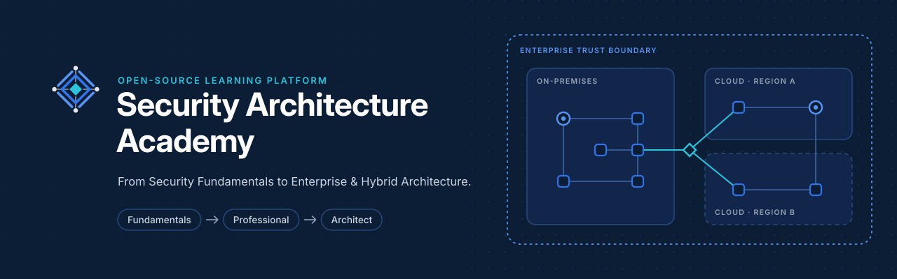

<picture>
  <source media="(prefers-color-scheme: dark)" srcset="docs/assets/branding/banner-dark.svg">
  <source media="(prefers-color-scheme: light)" srcset="docs/assets/branding/banner-light.svg">
  
</picture>

<h3>From Security Fundamentals to Enterprise &amp; Hybrid Architecture.</h3>

Formação aberta, gratuita e progressiva em Arquitetura de Segurança da Informação — dos princípios fundamentais às arquiteturas corporativas, cloud e híbridas.

  <a href="https://andrewsferreira.github.io/security-architecture-academy/"><strong>Página do projeto</strong></a>
  &nbsp;·&nbsp;
  <a href="LICENSE"><strong>Licença do conteúdo</strong></a>
  &nbsp;·&nbsp;
  <a href="LICENSE-CODE"><strong>Licença do código</strong></a>

## Objetivo

Formar profissionais capazes de projetar, avaliar e justificar arquiteturas de segurança em ambientes corporativos, cloud e híbridos. A formação é escrita em português brasileiro, preserva a terminologia técnica em inglês e ensina a raciocinar como arquiteto de segurança: entender o negócio e os riscos, transformar necessidades em requisitos, comparar alternativas com critérios explícitos e registrar decisões revisáveis.

## Fundamentos que serão tratados

O primeiro nível, **Fundamentals**, segue a sequência infraestrutura → segurança da informação → arquitetura de segurança:

| Módulo | Temas |
|:---|:---|
| **M00 — Fundamentos de Infraestrutura e Computação** | Sistemas operacionais e virtualização · redes TCP/IP · segmentação e conectividade · datacenters e alta disponibilidade · containers, APIs e serverless · modelos de cloud · leitura de diagramas arquiteturais |
| **M01 — Fundamentos de Segurança** | Propriedades de segurança · princípios de design seguro · trust boundaries e attack surface · criptografia aplicada · PKI, TLS e gestão de chaves · ameaça, vulnerabilidade e risco · modelos formais de segurança |
| **M02 — Introdução à Arquitetura de Segurança** | Papel do Security Architect · Enterprise, Solution e Security Architecture · arquitetura conceitual, lógica e física · princípios, padrões e exceções · arquiteturas de referência · frameworks · requisitos orientados ao negócio · Architecture Decision Records |

Também fazem parte do nível laboratórios locais sem custo, um estudo de caso, avaliações por módulo com gabaritos comentados e uma avaliação final integradora. Os níveis **Professional** e **Architect** serão publicados depois, de forma progressiva.

## Situação

As aulas estão em revisão e ainda não foram publicadas. Este repositório contém, por enquanto, apenas a página institucional do projeto, publicada em <https://andrewsferreira.github.io/security-architecture-academy/>.

## Licença

- Conteúdo educacional: [Creative Commons Attribution 4.0 International (CC BY 4.0)](LICENSE).
- Código e configuração: [MIT](LICENSE-CODE).
- Fontes Inter e JetBrains Mono: SIL Open Font License 1.1 (`docs/assets/fonts/`).
- Identidade visual (nome, logotipos e símbolos): todos os direitos reservados.

Projeto educacional independente, sem afiliação, patrocínio ou endosso das organizações, normas e certificações citadas.
