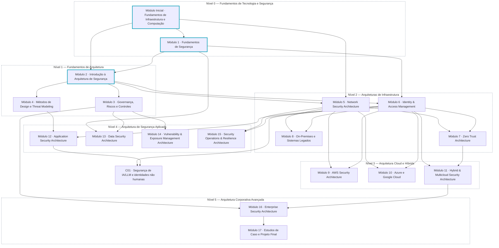

# Dependências entre módulos

O grafo abaixo mostra quais módulos são pré-requisitos de quais. Ele é **gerado automaticamente** a partir do manifesto, então qualquer mudança de pré-requisito aparece aqui sem edição manual. Módulos com contorno destacado já têm conteúdo produzido.

<!-- dependencies:start -->

<!-- dependencies:end -->

## Como usar o grafo

- **Ordem mínima:** antes de iniciar um módulo, conclua os módulos que apontam para ele.
- **Revisão de fundamentos:** módulos dos Níveis 2 a 5 retomam conceitos do Módulo Inicial e do Módulo 1 sempre que necessário; quem já domina esses fundamentos pode validar o conhecimento na [avaliação diagnóstica](../assessments/diagnostic-fundamentals.md) e avançar.
- **Ordem de produção ≠ ordem de estudo:** o Módulo 2 foi produzido primeiro por ser a referência de qualidade do curso. A ordem recomendada de estudo está no [plano de estudo](../learning-paths/study-plan.md).

## Justificativa das principais dependências

| Módulo | Depende de | Por quê |
|:---|:---|:---|
| Módulo 2 Introdução à Arquitetura | Módulo Inicial e Módulo 1 | Ler diagramas e conhecer princípios de segurança é condição para discutir arquitetura. |
| Módulo 3 — Governança, Riscos e Controles | Módulo 2 | Seleção de controles e arquitetura baseada em risco pressupõem o vocabulário de princípios, padrões e requisitos. |
| Módulo 7 Zero Trust | Módulos 5 e 6 | Zero Trust combina decisões de identidade com pontos de aplicação na rede e nos workloads. |
| Módulo 11 Hybrid & Multicloud | Módulos 6 e 7 | A integração híbrida depende de identidade federada e de decisões de acesso independentes de localização. |
| Módulo 16 — Enterprise Security Architecture | Módulos 3 e 11 | Governança corporativa entre empresas exige gestão de riscos e domínio de ambientes heterogêneos. |
| Módulo 17 Projeto Final | Módulo 16 | O projeto integra todas as competências em uma proposta corporativa completa. |
