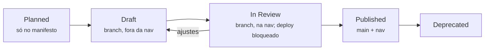

# Modelo de conteúdo

Define **como o conteúdo é estruturado, identificado e publicado**. As regras marcadas como *verificadas* são aplicadas automaticamente pelos scripts em `scripts/` e bloqueiam o merge quando violadas.

## Visão geral



## Hierarquia de conteúdo

```text
Trilha (Fundamentals · Professional · Advanced)
└── Nível (0 a 5)
    └── Módulo (M00…M17)            → docs/modules/NN-<slug>/index.md
        └── Aulas (M00-L01…)        → docs/modules/NN-<slug>/NN-<slug-da-aula>.md
Complementos (C01…)                 → docs/complements/<slug>/index.md
Atividades
├── Estudos de caso (CS-A…)         → docs/case-studies/<case-x-slug>/index.md, solution.md, adr-NNN-*.md
├── Laboratórios (LAB-02…)          → docs/labs/lab-NN-<slug>.md  +  examples/lab-NN-<slug>/
└── Avaliações (AS-DIAG, AS-M02…)   → docs/assessments/<slug>.md  +  docs/assessments/answers/<slug>.md
Artefatos do estudante (ART-…)      → docs/artifacts/<slug>.md
Conteúdo transversal                → docs/resources/, docs/certification-mapping/, docs/curriculum/
```

Os diretórios são criados **somente quando o primeiro conteúdo real chega** — não existem pastas ou páginas vazias no repositório. Gabaritos ficam **sempre** em arquivo separado (verificado: toda avaliação no manifesto declara `answers`).

## Templates de autoria

Cada tipo de conteúdo tem um template em `authoring/` (fora de `docs/`, para que não seja publicado). `docs/artifacts/` é outra coisa: modelos **para o estudante** usar nas entregas.

| Template | Arquivo | Uso |
|:---|:---|:---|
| Module Overview | `authoring/module-overview.md` | Página de entrada de um módulo |
| Technical Lesson | `authoring/technical-lesson.md` | Aula técnica — padrão de 14 elementos |
| Concept Explanation | `authoring/concept-explanation.md` | Explicação focada em um conceito |
| Architecture Pattern | `authoring/architecture-pattern.md` | Padrão reutilizável (problema → solução → trade-offs) |
| Reference Architecture | `authoring/reference-architecture.md` | Arquitetura de referência completa |
| Technical Lab | `authoring/technical-lab.md` | Laboratório — padrão de 10 elementos |
| Case Study | `authoring/case-study.md` | Estudo de caso fictício |
| Assessment | `authoring/assessment.md` | Avaliação com gabarito separado |
| Architecture Decision Record | `authoring/architecture-decision-record.md` | ADR |
| Threat Model | `authoring/threat-model.md` | Modelo de ameaças |
| Control Mapping | `authoring/control-mapping.md` | Mapeamento de controles entre frameworks |
| Glossary Entry | `authoring/glossary-entry.md` | Verbete do glossário |
| External Learning Resource | `authoring/external-resource.md` | Curadoria de recurso externo |

*Verificado:* todo template tem os campos de front matter obrigatórios, inicia com `status: draft` e contém as seções Resumo, Referências e Revisão.

### Padrão de aula (14 elementos)

Resumo · Conceito · Fundamentos técnicos · Exemplo empresarial · Arquitetura tradicional *versus* recomendada · Controles e padrões · Aplicabilidade (on-premises, cloud, híbrido) · Como especificar e implementar · Trade-offs e antipadrões · Como validar · Como apresentar e justificar · Checklist · Questões (respostas em `??? success`) · Exercício de decisão (matriz ponderada com resolução de referência) — seguidos de Pontos-chave, Referências e Revisão.

*Verificado:* toda tabela com coluna `Peso` e linha final `Total ponderado` tem os totais recalculados por `scripts/check_decision_matrices.py`.

### Padrão de laboratório (10 elementos)

Objetivo · Cenário empresarial · Requisitos · Arquitetura inicial · Passo a passo (com resultado esperado por passo) · Critérios de validação · Evidências esperadas · Perguntas arquiteturais · Explicação do resultado · Desmontagem. O campo `tested: true` só é usado depois de o laboratório ser executado de ponta a ponta; o código fica em `examples/` com testes executados no CI.

## Front matter

Campos comuns a todo conteúdo educacional:

```yaml
---
id: M02-L03                    # identificador estável (ver tabela abaixo)
title: Arquitetura conceitual, lógica e física
description: Uma frase (até ~160 caracteres) usada em SEO e compartilhamento.
domain: enterprise-architecture   # id de domínio do manifesto
tier: professional             # fundamental | professional | architect
status: draft                  # planned | draft | in-review | published | deprecated
prerequisites: [M02-L02]       # ids; lista vazia quando não houver
objectives:
  - Explicar ...
last_updated: 2026-10-23       # data da última revisão de conteúdo
reviewed_by: []                # revisores (GitHub handles) — obrigatório para publicar
---
```

| Tipo | Padrão de `id` | Exemplo |
|:---|:---|:---|
| Módulo | `M00` | `M07` |
| Aula | `M00-L00` | `M07-L03` |
| Complemento | `C00` | `C01` |
| Laboratório | `LAB-00` | `LAB-02` |
| Avaliação | `AS-<slug>` | `AS-DIAG`, `AS-M02` |
| Estudo de caso | `CS-<letra>` | `CS-A` |
| Artefato do estudante | `ART-<sigla>` | `ART-ADR` |
| ADR (dentro de um caso) | `ADR-000` | `ADR-002` |
| Glossário | `GL-<termo>` | `GL-trust-boundary` |

*Verificado:* toda página em `docs/` precisa de `description`; unidades declaradas no manifesto precisam de `id`, `title`, `description`, `status` e `last_updated` coerentes com ele, e aulas também de `tier`, `prerequisites` e `objectives`.

## Status editoriais

| Status | Onde o conteúdo existe | Na navegação? |
|:---|:---|:---|
| <span class="saa-status saa-status--planned">Planned</span> | Apenas no `curriculum/manifest.yml` | Não |
| <span class="saa-status saa-status--draft">Draft</span> | Branch de trabalho, em `docs/` | Não (erro se estiver) |
| <span class="saa-status saa-status--published">Published</span> | Branch de revisão ou Pull Request | Sim, para revisão no portal local — **bloqueado no deploy** |
| <span class="saa-status saa-status--published">Published</span> | `main` | **Sim** |
| <span class="saa-status saa-status--deprecated">Deprecated</span> | `main`, com aviso no topo | Sim, até remoção planejada |

O status **não depende da existência de um arquivo**: ele é declarado no front matter e no manifesto, e os dois precisam concordar. O workflow de deploy roda `validate_manifest.py --release` e `check_structure.py --release`, que falham com qualquer unidade `draft` ou `in-review`.

## Critérios de publicação

Um conteúdo só muda para `published` quando **todos** os critérios abaixo forem atendidos.

### Verificados automaticamente

- [x] Front matter completo e `status: published` igual ao manifesto.
- [x] Entrada correspondente em `nav` no `zensical.toml`.
- [x] `published_on` e `reviewed_by` preenchidos no manifesto.
- [x] Nenhum marcador de rascunho no texto (`TODO`, `TBD`, `{{ … }}` — sensível a maiúsculas).
- [x] Matrizes de decisão com totais corretos.
- [x] Laboratórios: testes de `examples/` passando.
- [x] Build sem erros e todos os links/âncoras internos válidos.
- [x] Diagramas com `accTitle`/`accDescr` e sintaxe válida.
- [x] Markdown lint sem erros.

### Verificados na revisão (checklist do Pull Request)

- [ ] Objetivos de aprendizagem cobertos pelo conteúdo e pelas atividades.
- [ ] Afirmações normativas com fonte, versão e data; fonte registrada em `research/bibliography.yml` como *Verified* e citada em `sources` com localização (capítulo, seção ou página quando verificável).
- [ ] Exemplos fictícios, sem dados, credenciais ou sistemas reais.
- [ ] Revisão técnica por pelo menos uma pessoa além do autor — ou, enquanto o projeto tiver um único mantenedor, auto-revisão com intervalo mínimo de 24 h entre escrita e aprovação, registrada no PR.
- [ ] Guia editorial e Design System respeitados.

## Curriculum manifest

`curriculum/manifest.yml` (schema v2) é a fonte única da estrutura curricular: `tiers`, `tracks`, `stages` (níveis 0–5), `phases`, `domains`, `modules` (com `lessons`), `complements`, `case_studies`, `labs`, `assessments` e `artifacts`. Campos por módulo:

| Campo | Obrigatório | Descrição |
|:---|:---|:---|
| `id` | sim | `M00`…`M17`, sequencial |
| `slug` | sim | kebab-case; define a pasta `docs/modules/NN-<slug>/` |
| `title` | sim | título exibido |
| `stage`, `phase` | sim | nível (que define a trilha) e fase de produção |
| `domains` | sim | lista de ids de domínio |
| `prerequisites` | sim | ids de módulos — o grafo não pode ter ciclos (verificado) |
| `status` | sim | status editorial |
| `lessons` | sim | aulas com `id`, `title`, `tier`, `minutes`, `status` e, a partir de `draft`, `file` |
| `path` | a partir de `draft` | caminho relativo a `docs/` da página do módulo |
| `published_on`, `reviewed_by` | para `published` | data `AAAA-MM-DD` e lista de revisores |
| `replaced_by` / `deprecation_note` | para `deprecated` | substituto ou justificativa |

São **gerados** a partir do manifesto e da Research Library (`make curriculum`): `CURRICULUM.md`, os blocos marcados de `docs/curriculum/index.md` e `docs/curriculum/dependencies.md`, e as páginas de `docs/resources/` (registro, livros, frameworks, cloud, matriz de referências e cobertura). O CI falha se estiverem desatualizados.

## Research Library e citações

As fontes ficam em `research/bibliography.yml`, com IDs estáveis (`BOOK-ANDERSON-SE3`, `NIST-SP800-207`, `SABSA-W101`…) e três estados independentes: acesso, redistribuição e verificação. Conceitos ficam em `research/knowledge-map.yml`, ligados a capítulo, seção ou página. Regras completas em `research/README.md` e na página *Metodologia de pesquisa* do portal.

Cada página de conteúdo declara no front matter:

| Campo | Uso | Verificado |
|:---|:---|:---|
| `sources` | Fontes que **sustentam** o texto | Os IDs existem e a fonte está *Verified* ou *Partially Verified* |
| `further_reading` | Leituras complementares, inclusive as acrescentadas depois da escrita | Os IDs existem |

A seção *Referências* da aula cita as mesmas fontes com localização (capítulo, seção e página quando verificáveis). Referências acrescentadas depois da escrita ficam em *Leituras de aprofundamento*, identificadas como posteriores ao texto.

## Adicionar um novo módulo

1. **Branch:** `git switch -c content/m03-governance-risk`.
2. **Página:** copie `authoring/module-overview.md` para `docs/modules/03-<slug>/index.md` e preencha o front matter (`id: M03`, `status: draft`).
3. **Manifesto:** mude o `status` do módulo para `draft` e adicione `path: modules/03-<slug>/index.md`.
4. **Aulas:** crie as aulas a partir de `authoring/technical-lesson.md`, na mesma pasta, e declare `file` e `status` de cada uma no manifesto.
5. **Validar:** `make curriculum && make validate && make test`. Rascunhos ficam fora da navegação.
6. **Revisão:** mude o status para `in-review` (página e manifesto) e adicione as páginas à `nav` para que o revisor navegue pelo portal local. O deploy continua bloqueado.
7. **Publicar:** após aprovação, mude para `published`, preencha `published_on` e `reviewed_by`, remova o aviso de revisão e faça o merge.
8. **Merge:** o workflow de publicação roda as validações com `--release`, que **impedem** qualquer conteúdo não publicado de chegar ao site.

Esse procedimento é aditivo: nenhuma página existente precisa mudar para que um módulo novo entre no site.
