# Fluxo de contribuição

Um fluxo enxuto, viável para um projeto mantido inicialmente por uma pessoa e pronto para receber colaboradores.

```mermaid
flowchart LR
  accTitle: Fluxo de contribuição
  accDescr: Uma issue descreve a mudança. O trabalho acontece em uma branch, é proposto em um Pull Request, validado automaticamente pelo CI, revisado e integrado à main do repositório de desenvolvimento. A publicação acontece por release: a árvore aprovada é exportada para o repositório público e o deploy é disparado manualmente.
  I["Issue"] --> B["Branch"] --> PR["Pull Request"] --> CI["Validação automática"] --> R["Review"] --> M["Merge na main"] --> X["Exportação da release"] --> P["Publicação manual"]
```



## 1. Issue

Toda mudança relevante começa com uma issue, usando um dos formulários:

| Formulário | Quando usar |
|:---|:---|
| Report a documentation error | Erro técnico, de digitação ou de tradução |
| Suggest new learning content | Proposta de tema, aula, laboratório ou estudo de caso |
| Report a broken resource | Link quebrado, imagem ausente, referência indisponível |
| Propose architecture improvements | Melhoria em diagrama, padrão ou reference architecture |
| Report technical problems | Problema no site, build, CI ou scripts |

Correções triviais (typo, link) podem ir direto para Pull Request.

## 2. Branch

Nome no formato `<tipo>/<descrição-curta>`:

| Prefixo | Uso | Exemplo |
|:---|:---|:---|
| `content/` | Conteúdo educacional | `content/m05-identity-federation` |
| `fix/` | Correções | `fix/broken-nist-link` |
| `design/` | Design System e assets | `design/card-spacing` |
| `ci/` | Automação | `ci/lychee-schedule` |
| `docs/` | Documentação do projeto | `docs/contributing-labels` |

## 3. Commits

Padrão [Conventional Commits](https://www.conventionalcommits.org/pt-br/v1.0.0/), em português ou inglês, no imperativo:

```text
<tipo>(<escopo opcional>): <descrição>

feat(m05): adicionar aula sobre federação de identidades
fix(links): corrigir referência ao NIST SP 800-63
docs(design-system): documentar tokens de espaçamento
ci: fixar versão do mermaid-cli
chore(deps): atualizar zensical para 0.0.72
```

Tipos: `feat` (conteúdo ou funcionalidade nova), `fix`, `docs`, `style` (visual), `refactor`, `ci`, `chore`, `test`.

## 4. Pull Request

- Preencha o template: tipo de mudança, issue relacionada e checklist.
- Mantenha PRs focados: **um módulo, um tema ou uma correção** por PR.
- Use *Draft Pull Request* enquanto o conteúdo estiver em `draft`.

## 5. Validação automática

O workflow **CI** roda em todo Pull Request, com permissões somente de leitura:

| Job | O que verifica | Bloqueia merge? |
|:---|:---|:---|
| `lint` | Markdown lint | Sim |
| `validate` | Estrutura, manifesto, Curriculum Roadmap, assets, contraste, build e links internos | Sim |
| `test` | Testes dos scripts de validação | Sim |
| `diagrams` | Sintaxe de todas as fontes Mermaid | Sim |

Links externos são verificados semanalmente pelo workflow **External links** — indisponibilidades de terceiros não bloqueiam PRs.

## 6. Review

- **Conteúdo:** revisão técnica com o checklist de [critérios de publicação](content-model.md#criterios-de-publicacao).
- **Infraestrutura:** confirmar que o CI passou e que a mudança é a menor possível.
- Comentários de revisão devem indicar se são **bloqueantes** ou **sugestões**.
- Enquanto houver um único mantenedor: auto-revisão com intervalo mínimo de 24 h para conteúdo, registrada no PR.

## 7. Merge

- Merge por **squash**, com título no padrão de commits.
- O merge **não publica nada**: o deploy é manual e acontece apenas no repositório público, por release (seção seguinte).
- Sem *force push* na `main` e sem reescrita de histórico.

## 8. Releases e publicação

A formação chega ao público em releases cumulativas por nível — Fundamentals, Professional e Architect —, definidas na seção `releases` do manifesto e controladas no plano de releases do repositório de desenvolvimento.

| Espaço | Papel |
|:---|:---|
| Repositório de desenvolvimento (privado) | Todo o trabalho, incluindo módulos em escrita e em revisão |
| Repositório público | Somente árvores exportadas de releases aprovadas; fonte do GitHub Pages |

Conteúdo em desenvolvimento nunca é enviado ao repositório público — nem em outra branch, nem escondido da navegação —, porque tudo o que entra em um repositório público fica acessível no histórico. O repositório público tem **histórico próprio**: recebe árvores exportadas, nunca objetos Git do desenvolvimento.

A árvore pública é montada por `scripts/export_release.py` em três filtros: arquivos versionados; **allowlist** explícita (`curriculum/public-allowlist.yml` — o que não está nela fica só no desenvolvimento, como os relatórios de processo); e **escopo da release**, pelo manifesto. Na raiz da árvore vai o `RELEASE-MANIFEST.yml`: versão, aulas, atividades, diagramas, referências, aprovação, commit privado de origem e o SHA-256 de cada arquivo.

1. **Candidata:** `make release-candidate RELEASE=R1` gera em `build/` a árvore pública e roda nela as validações, o build, os links, os testes, a verificação do manifesto de release e a verificação de atribuição de autoria (arquivos e site compilado).
2. **Revisão:** o mantenedor revisa o pacote de revisão e a árvore candidata, gerada a partir de um commit identificado. Correções voltam ao passo 1.
3. **Aprovação:** registrada pelo mantenedor no manifesto — `status: approved`, `approved_by`, `approved_on` e `approved_source_commit` (SHA completo do commit revisado). Nenhuma automação preenche esses campos.
4. **Exportação final:** `make release-export RELEASE=R1` confere que, entre o commit aprovado e o atual, só mudaram o manifesto e as páginas geradas a partir dele, e que não há alterações não commitadas; marca o escopo como `published`, com `reviewed_by` e `published_on` vindos da aprovação, e repete as validações em modo `--release`.
5. **Publicação:** commit da árvore no repositório público com a identidade do mantenedor, tag `vX.Y.Z`, push sem force e execução manual do workflow **Deploy to GitHub Pages** com a confirmação "publicar", a versão e o SHA completo do commit. O workflow só publica se a `main` for exatamente esse commit (e a tag, quando existir, apontar para ele), se a árvore corresponder ao `RELEASE-MANIFEST.yml` com aprovação registrada e se as verificações de atribuição, as validações `--release`, os testes, o build e os links passarem.
6. **Registro:** conferência do site; `published_on`, `url` e `public_commit` da release no manifesto do desenvolvimento; CHANGELOG e GitHub Release.

Correções em conteúdo já publicado seguem o mesmo caminho, como *patch*. Para retirar uma release, usa-se `git revert` no repositório público seguido de novo deploy — nunca force push.

## Labels

Conjunto recomendado (pode ser criado com `scripts/create_labels.sh`):

| Label | Cor | Uso |
|:---|:---|:---|
| `type: content` | `#1E5EC8` | Conteúdo educacional |
| `type: bug` | `#B91C1C` | Erro técnico ou de conteúdo |
| `type: design` | `#2CC4DA` | Identidade visual e Design System |
| `type: infrastructure` | `#475569` | Build, CI, scripts |
| `type: proposal` | `#8DB4F5` | Propostas a discutir |
| `level: fundamentals` | `#C3D2E8` | Nível do conteúdo |
| `level: professional` | `#8DB4F5` | Nível do conteúdo |
| `level: architect` | `#5B93F0` | Nível do conteúdo |
| `status: needs-triage` | `#FBBF24` | Aguardando análise |
| `status: accepted` | `#15803D` | Aprovado para execução |
| `status: blocked` | `#B45309` | Depende de outra entrega |
| `good first issue` | `#0B7F93` | Boa para novos colaboradores |
| `dependencies` | `#0C1D36` | Atualizações do Dependabot |

## Versionamento

- [Semantic Versioning](https://semver.org/lang/pt-BR/) aplicado às releases do conteúdo:
    - `0.1.0` — Fundamentals; `0.2.0` — Professional; `0.3.0` — Architect.
    - `1.0.0` depois da revisão institucional da formação completa.
    - **Minor:** novo nível ou novos módulos. **Patch:** correções em conteúdo publicado.
- Cada release tem entrada no `CHANGELOG.md` (formato [Keep a Changelog](https://keepachangelog.com/pt-BR/1.1.0/)) e uma GitHub Release com tag `vX.Y.Z` no repositório público.

## Atualização de referências

- O workflow **External links** roda semanalmente e gera um relatório de links externos quebrados.
- A cada nova versão relevante de um framework (por exemplo, NIST CSF, CIS Controls, OWASP Top 10):
    1. Abrir issue *Report a broken resource* ou *Propose architecture improvements*.
    2. Marcar as páginas afetadas com `!!! warning "Versão"`.
    3. Revisar o conteúdo, atualizar `last_updated` e remover o aviso.
- Revisão completa das referências de cada módulo publicado pelo menos uma vez por ano.
